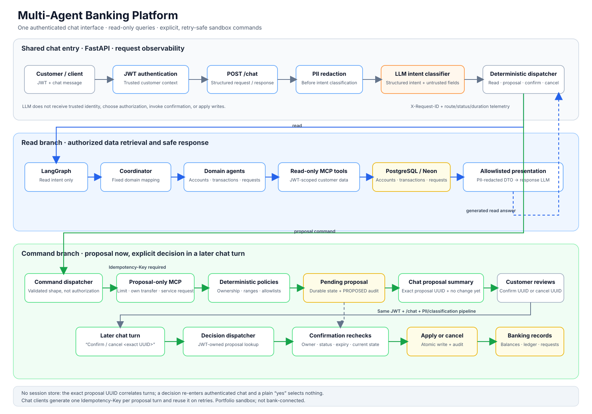

# Banking assistant architecture

## Architecture picture



## Editable Mermaid source

```mermaid
flowchart LR
    customer["Customer / API client"]

    subgraph app["FastAPI application"]
        auth["JWT authentication<br/>trusted customer context"]
        chat["POST /chat"]
        pii["Redact common PII"]
        classifier["LLM intent classification"]
        route{"Validated intent"}
        reject["Reject unsupported request"]

        subgraph reads["Read-only request path"]
            graph["LangGraph"]
            coordinator["Deterministic coordinator"]
            agents["Accounts / transactions /<br/>service-request agents"]
            readTools["Authenticated read-only MCP tools"]
            safeData["Presentation allowlist<br/>+ free-text PII redaction"]
            responseLLM["LLM response generation"]
        end

        subgraph commands["Chat command path"]
        commandRouter["Deterministic command dispatcher"]
        sessionStore["Encrypted chat session<br/>pending proposal ID"]
        proposalMCP["Proposal-only MCP tools"]
        policies["Deterministic policy + command services"]
        pending["Pending proposal<br/>+ audit event"]
        decisionMCP["Authenticated confirm/cancel dispatcher"]
        recheck["Owner + state + expiry + policy recheck"]
            apply["Apply confirmed command"]
            cancel["Cancel and audit"]
            commandReply["Return proposal ID / result to chat"]
        end
    end

    llm["Third-party LLM"]
    db[("PostgreSQL / Neon")]
    ledger["Balances · ledger · service requests<br/>durable command audit"]

    customer --> auth --> chat --> pii --> classifier --> llm
    llm -->|"structured intent and<br/>untrusted command fields"| route
    route -->|read| graph
    route -->|proposal or explicit decision| commandRouter
    route -->|unsupported / unknown| reject
    commandRouter --> sessionStore
    sessionStore --> db

    graph --> coordinator --> agents --> readTools --> db
    readTools --> safeData --> responseLLM --> llm
    llm -->|"generated read answer"| customer
    reject --> customer

    commandRouter -->|"proposal: client Idempotency-Key"|proposalMCP
    proposalMCP --> policies
    policies -->|valid proposal only| pending --> db
    policies -->|policy failure| commandReply
    pending --> commandReply --> customer

    customer -->|"new chat turn: confirm/cancel + exact proposal UUID"| auth
    commandRouter --> decisionMCP --> recheck
    recheck -->|confirm| apply --> ledger --> db
    recheck -->|cancel| cancel --> db
    apply --> commandReply
    cancel --> commandReply

    classDef read fill:#eff6ff,stroke:#60a5fa,color:#0f172a
    classDef command fill:#f0fdf4,stroke:#4ade80,color:#0f172a
    classDef external fill:#fff7ed,stroke:#fb923c,color:#0f172a
    classDef storage fill:#fefce8,stroke:#eab308,color:#0f172a
    class graph,coordinator,agents,readTools,safeData,responseLLM read
    class commandRouter,sessionStore,proposalMCP,policies,pending,decisionMCP,recheck,apply,cancel,commandReply command
    class llm external
    class db,ledger storage
```

Read requests and banking commands both enter through authenticated `/chat`.
For a write request, the LLM only extracts structured intent and untrusted
command fields. The application validates those fields and invokes an existing
proposal-only MCP tool; the proposal does not apply a change. Chat returns a
summary and proposal UUID, and stores that single pending proposal ID in an
AES-GCM encrypted session bound to the JWT customer. Follow-up phrases such as
“the other account” can resolve against previously listed account IDs. Confirm
and cancel from the console POST to `/chat/pending-proposal/confirm` or
`/cancel`, which use the stored ID. A chat message may still include that exact
UUID. The server never treats a bare “yes” as confirmation, even when a pending
proposal is in session, and it will not use a model-supplied UUID that was not
present in the user text. The server resolves the ID only among proposals owned
by the JWT-authenticated customer and rechecks the current state before any
write.

Proposal requests require an `Idempotency-Key` header, which a chat client
should generate once per logical user turn and reuse on transport retries.
Direct authenticated proposal and confirmation endpoints remain available for
Swagger/MCP testing. This is a portfolio sandbox, not a bank-connected
transaction system.
